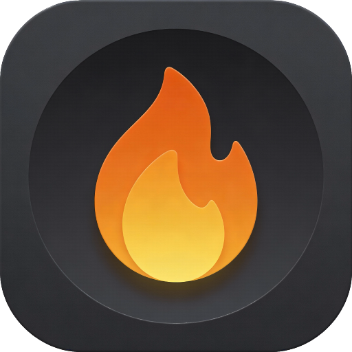

[English Description Below](#-faber-itc-for-home-assistant-1)

#  Faber ITC for Home Assistant

Steuere deinen Faber Gaskamin lokal über Home Assistant. Diese Integration verbindet sich direkt mit dem Faber ITC Controller in deinem Netzwerk – schnell, zuverlässig und ohne Cloud.

---

### 🚀 Features
- **Auto-Discovery:** Der Controller wird automatisch im Netzwerk gefunden.
- **Power & Status:** Kamin an-/ausschalten inkl. Anzeige des Zündvorgangs.
- **Flammensteuerung:** 5 Stufen inkl. permanenter **Zündflamme** (Pilot flame) und Wechsel zwischen schmalem/breitem Brenner.
- **Temperatur:** Aktuelle Raumtemperatur direkt vom Controller auslesen.
- **Flammenhöhe in Prozent:** `number`-Entität (0–100 % in 25-%-Schritten). 0 % schaltet den Kamin aus; ist er aus, zündet er und stellt danach die gewählte Höhe ein.
- **Flammenbreite:** `select`-Entität Schmal/Breit.
- **Thermostat:** `climate`-Entität, regelt die Flammenhöhe nach der Raumtemperatur des Controllers. Sie zündet und löscht den Kamin nie selbst und schaltet sich ab, sobald jemand die Flamme von Hand verstellt.
- **Langsame Rückmeldungen:** Der Controller meldet einen neuen Zustand erst nach einigen Sekunden (Zünden/Ausgehen ca. 40 s). Bis dahin zeigt HA „Zündet …“/„Geht aus …“ bzw. den gewählten Wert, statt zurückzuspringen.
- **Eigene Karte:** `custom:faber-itc-card` mit Drehregler für die Flammenhöhe (siehe unten).
- **Lokal:** Kommunikation erfolgt direkt über TCP (Port 58779).

---

### 📦 Installation

#### HACS (Empfohlen)
Füge diese URL als **Custom Repository** hinzu: `https://github.com/konkz/home-assistant-faber-itc` (Kategorie: Integration). Danach einfach installieren und HA neu starten.

#### Manuell
Kopiere den Ordner `custom_components/faber_itc` in dein HA-Verzeichnis und starte neu.

---

### ⚙️ Konfiguration
1. Gehe zu **Einstellungen > Geräte & Dienste**.
2. Suche nach **Faber ITC** (oder warte auf die automatische Entdeckung).
3. Bestätige die Einrichtung – fertig!

---

### ⚠️ Disclaimer
**Sicherheit geht vor:** Gasgeräte sind sensibel. Diese Integration basiert auf Reverse Engineering und ist nicht offiziell. Die Nutzung erfolgt auf eigene Gefahr. Lass deinen Kamin nie unbeaufsichtigt brennen.

---
*Getestet mit Aspect Premium RD L (M4435200)*

---

### 🔥 Kamin-Karte
Die Integration bringt eine eigene Karte mit: Drehregler für die Flammenhöhe, Schmal/Breit, Ein/Aus (gedrückt halten) und Thermostat. Die Texte erscheinen auf Deutsch oder Englisch, je nach HA-Sprache.

1. **Einstellungen > Dashboards > ⋮ > Ressourcen > Ressource hinzufügen:** URL `/faber_itc_card/faber-itc-card.js`, Typ **JavaScript-Modul**.
2. Karte hinzufügen:

```yaml
type: custom:faber-itc-card
# optional, bei mehreren Kaminen:
# device_id: <DEVICE_ID>
# name: Kamin
```

---

### 🎨 Dashboard (Empfehlung)
Für ein optimales Erlebnis mit der **Tile Card** (HA 2023.6+), kannst du folgendes YAML nutzen. Ersetze `<YOUR_DEVICE_ID>` durch die tatsächliche ID deines Kamins (z.B. `fireplace`).

```yaml
type: vertical-stack
cards:
  - type: tile
    entity: switch.<YOUR_DEVICE_ID>_fireplace
    name:
      type: device
    show_entity_picture: false
    hide_state: false
    state_content: hint
    vertical: false
    tap_action:
      action: none
    hold_action:
      action: toggle
    icon_tap_action:
      action: none
    features_position: inline
  - type: grid
    columns: 5
    square: false
    cards:
      - type: tile
        entity: switch.<YOUR_DEVICE_ID>_pilot_flame
        name:
          type: entity
        color: light-blue
        show_entity_picture: false
        hide_state: true
        vertical: true
        tap_action:
          action: toggle
        icon_tap_action:
          action: none
        features_position: bottom
      - type: tile
        entity: switch.<YOUR_DEVICE_ID>_level_1
        name:
          type: entity
        color: yellow
        hide_state: true
        vertical: true
        tap_action:
          action: toggle
        icon_tap_action:
          action: none
        features_position: bottom
      - type: tile
        entity: switch.<YOUR_DEVICE_ID>_level_2
        name:
          type: entity
        color: amber
        hide_state: true
        vertical: true
        tap_action:
          action: toggle
        icon_tap_action:
          action: none
        features_position: bottom
      - type: tile
        entity: switch.<YOUR_DEVICE_ID>_level_3
        name:
          type: entity
        color: orange
        hide_state: true
        vertical: true
        tap_action:
          action: toggle
        icon_tap_action:
          action: none
        features_position: bottom
      - type: tile
        entity: switch.<YOUR_DEVICE_ID>_level_4
        name:
          type: entity
        color: red
        hide_state: true
        vertical: true
        tap_action:
          action: toggle
        icon_tap_action:
          action: none
        features_position: bottom
  - square: false
    type: grid
    cards:
      - type: tile
        entity: sensor.<YOUR_DEVICE_ID>_installer
        name: " "
        icon: mdi:campfire
        color: disabled
        show_entity_picture: false
        hide_state: true
        vertical: true
        tap_action:
          action: none
        hold_action:
          action: none
        double_tap_action:
          action: none
        icon_tap_action:
          action: none
        icon_hold_action:
          action: none
        features_position: bottom
      - type: tile
        entity: switch.<YOUR_DEVICE_ID>_narrow
        name:
          type: entity
        color: blue
        hide_state: true
        vertical: true
        tap_action:
          action: toggle
        icon_tap_action:
          action: none
        features_position: bottom
      - type: tile
        entity: switch.<YOUR_DEVICE_ID>_wide
        name:
          type: entity
        color: indigo
        hide_state: true
        vertical: true
        tap_action:
          action: toggle
        icon_tap_action:
          action: none
        features_position: bottom
      - type: tile
        entity: sensor.<YOUR_DEVICE_ID>_installer
        name: " "
        icon: mdi:campfire
        color: disabled
        show_entity_picture: false
        hide_state: true
        vertical: true
        tap_action:
          action: none
        hold_action:
          action: none
        double_tap_action:
          action: none
        icon_tap_action:
          action: none
        icon_hold_action:
          action: none
        features_position: bottom
    columns: 4
  - type: tile
    entity: sensor.<YOUR_DEVICE_ID>_temperature
    name:
      type: entity
    color: blue-grey
    vertical: false
    features:
      - type: trend-graph
        hours_to_show: 8
    features_position: bottom
```

<br>
<br>

#  Faber ITC for Home Assistant

Control your Faber gas fireplace locally via Home Assistant. This integration connects directly to the Faber ITC controller in your network – fast, reliable, and cloud-free.

---

### 🚀 Features
- **Auto-Discovery:** Controller is automatically found on your network.
- **Power & Status:** Turn fireplace on/off including ignition status.
- **Flame Control:** 5 levels including permanent **Pilot flame** and toggle between narrow/wide burners.
- **Temperature:** Read current room temperature directly from the controller.
- **Flame height in percent:** `number` entity (0–100 % in 25 % steps). 0 % turns the fireplace off; if it is off, it ignites and then sets the chosen height.
- **Flame width:** `select` entity narrow/wide.
- **Thermostat:** `climate` entity that adjusts the flame height to the controller's room temperature. It never ignites or turns off the fireplace and switches itself off as soon as someone changes the flame by hand.
- **Slow feedback:** The controller reports a new state only after a few seconds (ignition/turning off about 40 s). Until then HA shows "Igniting …"/"Turning off …" or the chosen value instead of jumping back.
- **Custom card:** `custom:faber-itc-card` with a dial for the flame height (see below).
- **Local:** Communication via direct TCP (Port 58779).

---

### 📦 Installation

#### HACS (Recommended)
Add this URL as a **Custom Repository**: `https://github.com/konkz/home-assistant-faber-itc` (Category: Integration). Then install and restart HA.

#### Manual
Copy the `custom_components/faber_itc` folder to your HA directory and restart.

---

### ⚙️ Configuration
1. Go to **Settings > Devices & Services**.
2. Search for **Faber ITC** (or wait for automatic discovery).
3. Confirm the setup – that's it!

---

### ⚠️ Disclaimer
**Safety first:** Gas appliances are sensitive. This integration is based on reverse engineering and is unofficial. Use at your own risk. Never leave your fireplace burning unattended.

---
*Tested with Aspect Premium RD L (M4435200)*

---

### 🔥 Fireplace card
The integration ships its own card: a dial for the flame height, narrow/wide, on/off (press and hold) and the thermostat. Texts are shown in German or English, depending on the HA language.

1. **Settings > Dashboards > ⋮ > Resources > Add resource:** URL `/faber_itc_card/faber-itc-card.js`, type **JavaScript module**.
2. Add the card:

```yaml
type: custom:faber-itc-card
# optional, with several fireplaces:
# device_id: <DEVICE_ID>
# name: Fireplace
```

---

### 🎨 Dashboard (Recommended)
For the best experience using the **Tile Card** (HA 2023.6+), you can use this YAML. Replace `<YOUR_DEVICE_ID>` with the actual ID of your fireplace (e.g., `fireplace`).

```yaml
type: vertical-stack
cards:
  - type: tile
    entity: switch.<YOUR_DEVICE_ID>_fireplace
    name:
      type: device
    show_entity_picture: false
    hide_state: false
    state_content: hint
    vertical: false
    tap_action:
      action: none
    hold_action:
      action: toggle
    icon_tap_action:
      action: none
    features_position: inline
  - type: grid
    columns: 5
    square: false
    cards:
      - type: tile
        entity: switch.<YOUR_DEVICE_ID>_pilot_flame
        name:
          type: entity
        color: light-blue
        show_entity_picture: false
        hide_state: true
        vertical: true
        tap_action:
          action: toggle
        icon_tap_action:
          action: none
        features_position: bottom
      - type: tile
        entity: switch.<YOUR_DEVICE_ID>_level_1
        name:
          type: entity
        color: yellow
        hide_state: true
        vertical: true
        tap_action:
          action: toggle
        icon_tap_action:
          action: none
        features_position: bottom
      - type: tile
        entity: switch.<YOUR_DEVICE_ID>_level_2
        name:
          type: entity
        color: amber
        hide_state: true
        vertical: true
        tap_action:
          action: toggle
        icon_tap_action:
          action: none
        features_position: bottom
      - type: tile
        entity: switch.<YOUR_DEVICE_ID>_level_3
        name:
          type: entity
        color: orange
        hide_state: true
        vertical: true
        tap_action:
          action: toggle
        icon_tap_action:
          action: none
        features_position: bottom
      - type: tile
        entity: switch.<YOUR_DEVICE_ID>_level_4
        name:
          type: entity
        color: red
        hide_state: true
        vertical: true
        tap_action:
          action: toggle
        icon_tap_action:
          action: none
        features_position: bottom
  - square: false
    type: grid
    cards:
      - type: tile
        entity: sensor.<YOUR_DEVICE_ID>_installer
        name: " "
        icon: mdi:campfire
        color: disabled
        show_entity_picture: false
        hide_state: true
        vertical: true
        tap_action:
          action: none
        hold_action:
          action: none
        double_tap_action:
          action: none
        icon_tap_action:
          action: none
        icon_hold_action:
          action: none
        features_position: bottom
      - type: tile
        entity: switch.<YOUR_DEVICE_ID>_narrow
        name:
          type: entity
        color: blue
        hide_state: true
        vertical: true
        tap_action:
          action: toggle
        icon_tap_action:
          action: none
        features_position: bottom
      - type: tile
        entity: switch.<YOUR_DEVICE_ID>_wide
        name:
          type: entity
        color: indigo
        hide_state: true
        vertical: true
        tap_action:
          action: toggle
        icon_tap_action:
          action: none
        features_position: bottom
      - type: tile
        entity: sensor.<YOUR_DEVICE_ID>_installer
        name: " "
        icon: mdi:campfire
        color: disabled
        show_entity_picture: false
        hide_state: true
        vertical: true
        tap_action:
          action: none
        hold_action:
          action: none
        double_tap_action:
          action: none
        icon_tap_action:
          action: none
        icon_hold_action:
          action: none
        features_position: bottom
    columns: 4
  - type: tile
    entity: sensor.<YOUR_DEVICE_ID>_temperature
    name:
      type: entity
    color: blue-grey
    vertical: false
    features:
      - type: trend-graph
        hours_to_show: 8
    features_position: bottom
```